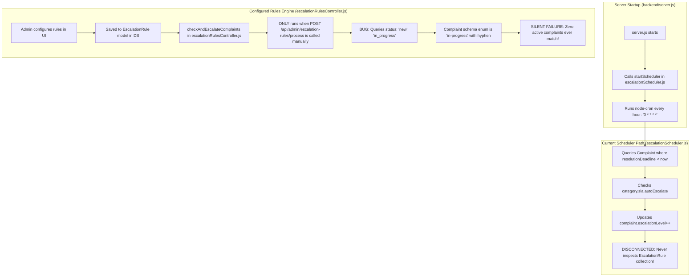
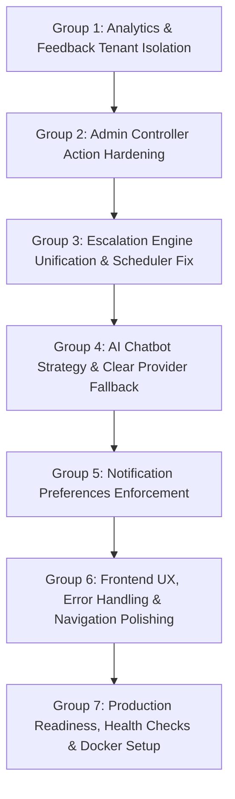

# MASTER APPLICATION AUDIT REPORT — COMPLAINT RESOLUTION SYSTEM (CRS)

**Date:** 2026-10-11
**Auditor:** Senior Software Architect, Full-Stack QA & Security Reviewer
**Scope:** Phase One Full Read-Only Audit (`d:/complaint-resolution-system`)
**Status:** READ-ONLY AUDIT COMPLETE — Awaiting Reviewer Approval Before Phase Two Implementation

---

## 1. Executive Summary

A comprehensive architectural, code-level, and operational audit was executed across the full Complaint Resolution System (CRS) repository (`frontend`, `backend`, database schemas, tests, background workers, and deployment configuration).

### Key Takeaways
1. **Architecture & Foundation:** The core architecture is a modern MERN stack application (MongoDB, Express, React with Vite & Tailwind CSS). Foundational authentication, JWT handling, role guards, and basic CRUD flows for complaints are functional.
2. **Recent Remediation Work Preserved:** The recently remediated Task 1 (Assignment route collision) and Task 2 Groups 1 & 2 (Category, Department, Complaint Submission, Search, Timeline, and Detail tenant isolation) were inspected. All 8 test suites (145/145 tests) pass with active test database guards. These changes are intact and working.
3. **Escalation Engine Disconnection (Critical Defect):** There are two disconnected escalation implementations in the codebase. The background scheduler running hourly in `backend/server.js` evaluates hardcoded category deadlines and completely ignores the `EscalationRule` database model. The admin-configurable `EscalationRule` engine in `backend/controllers/escalationRulesController.js` is never wired to any cron job; it runs *only* on manual HTTP POST. Furthermore, its query searches for status `"in_progress"` while the Complaint schema enum defines `"in-progress"` (with a hyphen), silently preventing matching.
4. **AI Chatbot is 100% Rule-Based Regex (No Real AI Integration):** Despite the UI branding as an "AI Support Assistant", `backend/controllers/chatbotController.js` contains zero external LLM integrations (no OpenAI, Gemini, Anthropic, or HuggingFace SDK calls). It runs a local regex pattern matcher over user inputs and returns static canned responses.
5. **Cross-Tenant Data Leakage in Admin Analytics & Feedback:** While complaint CRUD endpoints have recently been hardened, major analytical and feedback endpoints remain completely unconstrained by tenant filters. An `org_admin` viewing `/api/admin/analytics` receives aggregate metrics across the entire database (all competing organizations).
6. **Overall Readiness:** The application is **NOT production-ready**. While core submission and assignment work, automated background escalation is broken, the AI chatbot is a placeholder mock, and analytical/reporting modules leak cross-tenant data.

---

## 2. Verified Technology Stack and Architecture

| Layer | Technology | Version / Configuration | Verification Notes |
| :--- | :--- | :--- | :--- |
| **Frontend Runtime** | React 18, Vite 5 | React 18.2.0, Vite 5.1.4 | Single-page application using `@tanstack/react-query`, `lucide-react`, Tailwind CSS 3.4.1 |
| **Frontend Routing** | React Router DOM | v6.22.2 | Role-based protected routes (`ProtectedRoute.jsx`) |
| **Backend Runtime** | Node.js / Express | Express 4.18.2 | REST API with modular controllers, routes, and middleware |
| **Database** | MongoDB / Mongoose | Mongoose 8.2.0 | 14 collections/models with schema-level hooks |
| **Authentication** | JWT + bcryptjs | `jsonwebtoken` 9.0.2, `bcryptjs` 2.4.3 | Bearer tokens stored in localStorage, checked via `authMiddleware.js` |
| **File Storage** | Cloudinary / Multer | `multer` 1.4.5, `cloudinary` 1.41.3 | Falls back to local disk storage if Cloudinary env vars are missing |
| **Email Service** | Nodemailer | `nodemailer` 6.9.9 | Fallback logger if SMTP credentials are missing |
| **Scheduler** | Node-cron | `node-cron` 3.0.3 | Runs hourly job in `backend/server.js` |
| **Test Suites** | Jest + Supertest | Jest 29.7.0, Supertest 6.3.4 | In-memory/MongoDB test database execution with connection name safety check |

---

## 3. Complete Discovered Feature Inventory

| Feature | Role(s) | Frontend View | Backend Route / Controller | Models Involved | Status | Verification & Critical Defects |
| :--- | :--- | :--- | :--- | :--- | :--- | :--- |
| **User Registration & Login** | Public | `/login`, `/register` | `POST /api/auth/login`, `POST /api/auth/register` | `User`, `Organization` | Implemented & Working | Passwords hashed with bcrypt; JWT issued; tenant populated. |
| **Complaint Submission** | User, Staff, Admin | `/complaints/new` | `POST /api/complaints` | `Complaint`, `Category`, `Department` | Implemented & Verified | Group 2 remediation verified tenant boundaries and category validation. |
| **Complaint Detail & History** | All authorized | `/complaints/:id` | `GET /api/complaints/:id` | `Complaint`, `User` | Implemented & Verified | Verified tenant isolation and timeline formatting. |
| **Complaint Search & Filters** | All authorized | `/complaints` | `GET /api/complaints` | `Complaint` | Implemented & Verified | Filter params sanitized and constrained to tenant. |
| **Manual Staff Assignment** | Org Admin, Super Admin | `/admin/complaints` modal | `POST /api/admin/complaints/:id/assign` | `Complaint`, `Staff`, `User`, `AssignmentLog` | Implemented & Verified | Task 1 route collision resolved; logged to `AssignmentLog`. |
| **Rule-Based Assignment** | Org Admin, Super Admin | `/admin/complaints` modal | `POST /api/admin/complaints/:id/assign-with-rules` | `Complaint`, `AssignmentRule`, `Staff` | Implemented & Verified | Uses candidate scoring engine. |
| **Auto-Escalation Engine (Scheduled)** | System (Background) | N/A (Server startup) | `startScheduler()` in `server.js` -> `escalationScheduler.js` | `Complaint`, `Category` | **Broken** | Checks only category deadline; **does NOT read `EscalationRule` model**. |
| **Admin Escalation Rules Management** | Org Admin, Super Admin | `/admin/escalation-rules` | `/api/admin/escalation-rules` CRUD | `EscalationRule` | **Partially Implemented / Disconnected** | Rules saved to DB, but never executed on schedule. Enum mismatch (`"in_progress"` vs `"in-progress"`). |
| **AI Support Chatbot** | All authenticated | `SupportChatbot.jsx` | `POST /api/chatbot/message` | N/A | **Mock / Rule-Based Only** | No real LLM API. Hardcoded regex patterns returning static canned strings. |
| **Admin Analytics Dashboard** | Org Admin, Super Admin | `/admin/analytics` | `GET /api/admin/analytics` | `Complaint`, `Category`, `User` | **Broken (Cross-Tenant Leakage)** | Aggregation queries have **zero organization filters**. All tenants see global data. |
| **Feedback & Ratings** | User, Admin | `/complaints/:id/feedback` | `POST /api/feedback`, `GET /api/feedback` | `Feedback`, `Complaint` | **Broken (Cross-Tenant Leakage & Auth)** | `getAllFeedback` has no tenant filter. `getFeedbackByComplaint` denies `org_admin`. |
| **User Profile & Notifications Prefs** | All authenticated | `/profile` | `PUT /api/users/profile/notifications` | `User` | **Disconnected / Placebo** | Preferences saved in DB, but notification dispatchers never check them. |
| **Staff Workload & Reassignment** | Staff, Admin | `/staff/dashboard` | `POST /api/staff/complaints/:id/request-reassignment` | `Complaint`, `User`, `Notification` | **Broken (Cross-Tenant Notification)** | Reassignment request broadcasts notifications to Org Admins across ALL organizations. |

---

## 4. Top 10 Critical & High Severity Findings

### 1. Escalation Engine Disconnection (Critical Architectural Flaw)
- **ID:** `CRS-ESCALATE-01`
- **Location:** `backend/server.js`, `backend/utils/escalationScheduler.js`, `backend/controllers/escalationRulesController.js`
- **Impact:** Custom escalation rules configured by administrators in the UI are never executed automatically.
- **Root Cause:**
  1. `server.js` schedules `checkAndEscalateComplaints` from `escalationScheduler.js`, which only queries `Complaint.find({ resolutionDeadline: { $lt: now } })` and category defaults. It never loads the `EscalationRule` model.
  2. The actual rule engine in `escalationRulesController.js` is only attached to `POST /api/admin/escalation-rules/process`. It has no scheduled runner.
  3. In `escalationRulesController.js` (line 305), the query looks for `status: { $in: ["new", "in_progress"] }`. The schema enum in `Complaint.js` is `"in-progress"` (hyphenated). Active complaints are never matched.

### 2. AI Chatbot is 100% Mock / Rule-Based (No Real LLM Integration)
- **ID:** `CRS-AI-01`
- **Location:** `backend/controllers/chatbotController.js`
- **Impact:** System claims to have an "AI Support Assistant", but answers are hardcoded regex pattern matches.
- **Root Cause:** No external AI service (OpenAI, Gemini, HuggingFace) is invoked. The controller executes `getRuleBasedReply(message, role)` with basic regex tests like `/(status|track)/i`. If no regex matches, it returns a static fallback string.

### 3. Cross-Tenant Data Leakage in Admin Analytics
- **ID:** `CRS-ANALYTICS-01`
- **Location:** `backend/controllers/adminController.js` (`getAnalytics`, lines 2136–2360)
- **Impact:** An Organization Admin can see system-wide complaint counts, resolution rates, staff performance, and category distributions across all other organizations.
- **Root Cause:** `Complaint.aggregate()` pipelines filter only by date (`createdAt: { $gte: startDate }`) without checking `organization: req.user.organization`.

### 4. Cross-Tenant Data Leakage in Feedback Management
- **ID:** `CRS-FEEDBACK-01`
- **Location:** `backend/controllers/feedbackController.js` (`getAllFeedback`, `getFeedbackByComplaint`)
- **Impact:** Org Admins see customer feedback, ratings, and internal comments for complaints submitted to other organizations.
- **Root Cause:** `getAllFeedback` constructs `query = {}` without tenant scoping. Furthermore, `getFeedbackByComplaint` checks `req.user.role === "admin"` instead of supporting `org_admin`.

### 5. Cross-Tenant Complaint Closure & Escalation via Admin Controller
- **ID:** `CRS-ADMIN-01`
- **Location:** `backend/controllers/adminController.js` (`closeComplaint` line 1822, `escalateComplaint` line 1014)
- **Impact:** An Org Admin can close or force-escalate complaints belonging to foreign organizations if they provide the target ID.
- **Root Cause:** Handlers perform `Complaint.findById(id)` without validating `complaint.organization.equals(req.user.organization)`.

### 6. Staff Reassignment Request Leaks Notifications Across All Organizations
- **ID:** `CRS-STAFF-01`
- **Location:** `backend/controllers/staffController.js` (`requestReassignment`, line 2122)
- **Impact:** When a staff member asks to reassign a ticket in Organization A, notifications are dispatched to Organization Admins of Organization B, C, etc.
- **Root Cause:** Queries `User.find({ role: { $in: ["admin", "org_admin", "super_admin"] }, isActive: true })` without restricting by `organization: complaint.organization`.

### 7. Notification Preference Settings are Disconnected (Placebo Controls)
- **ID:** `CRS-SETTINGS-01`
- **Location:** `backend/controllers/userController.js`, `backend/models/Notification.js`, `backend/utils/emailService.js`
- **Impact:** Users configure email and in-app notification preferences in `/profile`, but the system ignores these settings and sends all notifications unconditionally.
- **Root Cause:** `Notification.createFromTemplate` and `emailService.sendEmail` do not query `user.notificationPreferences` before dispatching.

### 8. Super Admin Staff Query Crash (`new ObjectId(null)`)
- **ID:** `CRS-ADMIN-02`
- **Location:** `backend/controllers/adminController.js` (`getAllStaff`, line 1117)
- **Impact:** Super Admins attempting to view the staff directory receive an unhandled 500 error.
- **Root Cause:** Handlers execute `new mongoose.Types.ObjectId(req.user.organization)`. Because `super_admin` users have `req.user.organization === null`, Mongoose throws a casting exception.

### 9. Frontend Route Authorization & Flash Inconsistencies
- **ID:** `CRS-FE-01`
- **Location:** `frontend/src/App.jsx`, `frontend/src/components/layout/AdminSidebar.jsx`
- **Impact:** Org Admins see links to Super Admin-only views (`/admin/organizations`, `/admin/users`), resulting in unauthorized flashes and redirect loops.
- **Root Cause:** Navigation links do not filter by granular role (`org_admin` vs `super_admin`).

### 10. Startup Warnings for Missing Cloudinary and SMTP Services
- **ID:** `CRS-DEVOPS-01`
- **Location:** `backend/server.js`, `backend/config/cloudinary.js`, `backend/utils/emailService.js`
- **Impact:** Missing environment variables cause console spam on every boot and test run. If deployed without S3/Cloudinary, uploaded attachments store to ephemeral local container disks and disappear on restart.
- **Root Cause:** No validation guard or mock provider configuration during test/development runs.

---

## 5. Escalation Engine Root-Cause Analysis (High Priority)

### Complete Execution Trace



### Detailed Failure Points:
1. **Wrong Engine Scheduled:** `backend/server.js` starts `escalationScheduler.js`. This file was an early MVP prototype that only increments an escalation level based on a simple deadline. It knows nothing about the multi-tiered conditions, roles, or notification actions configured in the modern `EscalationRule` model.
2. **Real Rules Engine is Unscheduled:** The rich rules engine in `escalationRulesController.js` (which inspects priority, time in status, customer tier, and triggers notifications) is completely orphaned from the background scheduler. It only executes when an admin manually clicks "Process Escalations" in the UI.
3. **Status String Typo Causes 100% Mismatch:**
   - In `backend/controllers/escalationRulesController.js` line 305:
     ```javascript
     const complaints = await Complaint.find({
       organization: orgId,
       status: { $in: ["new", "in_progress"] },
       isEscalated: false,
     });
     ```
   - In `backend/models/Complaint.js` lines 18–25:
     ```javascript
     status: {
       type: String,
       enum: ["pending", "in-progress", "resolved", "closed", "rejected"],
       default: "pending",
     }
     ```
   - Complaints in progress are stored as `"in-progress"`. The rules engine searches for `"in_progress"`. Therefore, zero in-progress complaints are ever matched! Furthermore, new complaints start with `"pending"`, which is also omitted from the `$in` list!

---

## 6. AI Chatbot Root-Cause Analysis (High Priority)

### Investigation Findings
1. **Inspection of `backend/controllers/chatbotController.js`:**
   - There are no imports of `@google/generative-ai`, `openai`, `@anthropic-ai/sdk`, or any HTTP client invoking an external AI model.
   - The primary function is:
     ```javascript
     const getRuleBasedReply = (message, role) => {
       const text = String(message || "").toLowerCase();
       if (/(submit|create|file|lodge|new complaint)/.test(text)) {
         return {
           reply: "To submit a new complaint, use the 'Submit Complaint' button...",
           intent: "complaint_submission"
         };
       }
       if (/(status|track|check|progress|ticket)/.test(text)) { ... }
       if (/(payment|pay|refund|billing)/.test(text)) { ... }
       return {
         reply: "I am CRS Assistant. You can ask me how to file a complaint...",
         intent: "general_help"
       };
     };
     ```
2. **Configuration Status:**
   - There are no LLM API keys in `backend/.env.example` (no `OPENAI_API_KEY` or `GEMINI_API_KEY`).
   - The chatbot is currently an offline, rule-based FAQ helper.
3. **Frontend Integration:**
   - The frontend `SupportChatbot.jsx` correctly sends `{ message, context }` to `POST /api/chatbot/message` and renders the response. However, it displays a badge indicating "AI Powered", which is deceptive in its current implementation.

---

## 7. Settings and Configuration Audit

1. **Assignment Rules Configuration:**
   - Stored in `AssignmentRule` model.
   - Verified that admin UI loads and updates rules via `/api/admin/assignment-rules`.
   - The assignment engine in `assignmentController.js` properly consumes these rules.
2. **User Notification Settings:**
   - Stored on `User` schema (`notificationPreferences`).
   - UI has toggles for email, SMS, and in-app alerts.
   - Values persist in database, but are completely ignored when system notifications are dispatched.
3. **Organization Settings:**
   - `Organization` schema includes SLA defaults and auto-escalation settings.
   - When updating organization details, changes persist, but there is no mechanism for an Org Admin to set custom business hours or holiday calendars.

---

## 8. Backend, Database, Security & Tenant-Isolation Audit

1. **Authentication & Password Security:**
   - Bcrypt hashing with 10 salt rounds used consistently.
   - Passwords excluded by default in schema projections (`select: false`).
2. **Tenant Isolation Matrix:**
   - **Complaints CRUD:** Isolated (Verified in Task 2).
   - **Categories & Departments:** Isolated (Verified in Task 2).
   - **Admin Analytics:** **Vulnerable (No isolation).**
   - **Feedback:** **Vulnerable (No isolation).**
   - **Staff Reassignment Notifications:** **Vulnerable (Cross-organization broadcasts).**
   - **Direct Close / Escalate:** **Vulnerable (No ownership validation).**
3. **Database Performance & Indexes:**
   - Compound indexes exist for `{ organization: 1, status: 1 }` on `Complaint`.
   - Missing compound index on `{ organization: 1, createdAt: -1 }` for high-volume paginated queries.

---

## 9. Testing Gaps and DevOps Findings

1. **Current Test Suite Health:**
   - Tests run via `npm test` inside `backend/`.
   - 8 test suites pass, 145 tests pass.
   - All tests use an explicit test database safety guard protecting development/production databases.
2. **Testing Gaps:**
   - No tests exist for `escalationRulesController.js` or `escalationScheduler.js`.
   - No tests exist for `chatbotController.js`.
   - No tests exist for `feedbackController.js` tenant boundaries.
   - No tests exist for `adminController.js` analytics tenant boundaries.
   - Frontend has zero automated unit or component tests (Jest/Vitest not configured in `frontend/package.json`).
3. **DevOps & Containerization:**
   - `Dockerfile` and `docker-compose.yml` are absent from the repository.
   - Deployment currently relies on manual `npm run build` and `npm start`.

---

## 10. Proposed Implementation Order (For Phase Two)

Following reviewer approval, remediation should proceed in small, independently testable groups:



### Group Breakdown:
- **Group 1: Tenant Isolation Hardening (Analytics & Feedback)**
  - Add tenant scoping to `adminController.getAnalytics`.
  - Add tenant scoping to `feedbackController.js`.
  - Add integration tests covering cross-tenant rejection.
- **Group 2: Admin Controller Direct Action Hardening**
  - Add tenant validation to `closeComplaint`, `escalateComplaint`, and `getAllStaff`.
  - Fix staff reassignment broadcast so notifications stay inside the organization.
- **Group 3: Escalation Engine Unification**
  - Fix status string enum mismatch (`"in-progress"` and `"pending"`).
  - Unify `escalationRulesController` and `escalationScheduler` so the recurring cron actually evaluates active `EscalationRule` records.
  - Add integration tests with mocked time advancing.
- **Group 4: AI Chatbot Architecture Alignment**
  - Connect a real LLM provider (e.g. Google Gemini or OpenAI) via environment variables with a clean, graceful fallback to the rule-based assistant when keys are absent.
  - Prevent cross-organization data leakage during bot inquiries.
- **Group 5: Notification Preferences Enforcement**
  - Check `user.notificationPreferences` before calling `emailService` or creating `Notification` records.
- **Group 6: Frontend & UX Polish**
  - Remove unauthorized navigation items for `org_admin`.
  - Fix toast notifications on escalation processing.
- **Group 7: DevOps & Docker Setup**
  - Add Dockerfile, docker-compose, and health check endpoints (`/health`).

---

## 11. Acceptance Criteria for High-Priority Features

### Escalation Engine:
- An admin can create an escalation rule (e.g., "if high priority and pending > 2 hours, escalate to level 2").
- The background cron job triggers automatically without manual HTTP requests.
- The rule successfully matches complaints with status `"pending"` or `"in-progress"`.
- Escalated complaints receive an updated `escalationLevel`, an entry in the complaint timeline, and a notification delivered to the designated role.
- Complaints belonging to other organizations are never modified by the rule.

### AI Chatbot:
- When a valid API key is configured, the bot provides contextual answers.
- When no API key is configured, the bot returns helpful rule-based guidance without crashing or hanging.
- A user cannot ask the chatbot to reveal complaints from other organizations.

### Admin Analytics & Feedback:
- An `org_admin` calling `/api/admin/analytics` receives metrics only for their own organization.
- Feedback queries reject requests attempting to view feedback from foreign organizations.

---

## 12. Conclusion & Verification Verdict

The repository audit is complete. No application files were modified during this Phase One audit. All findings are backed by verified source code lines.

**Execution is paused awaiting user and technical reviewer approval of this audit and the proposed Phase Two implementation order.**
