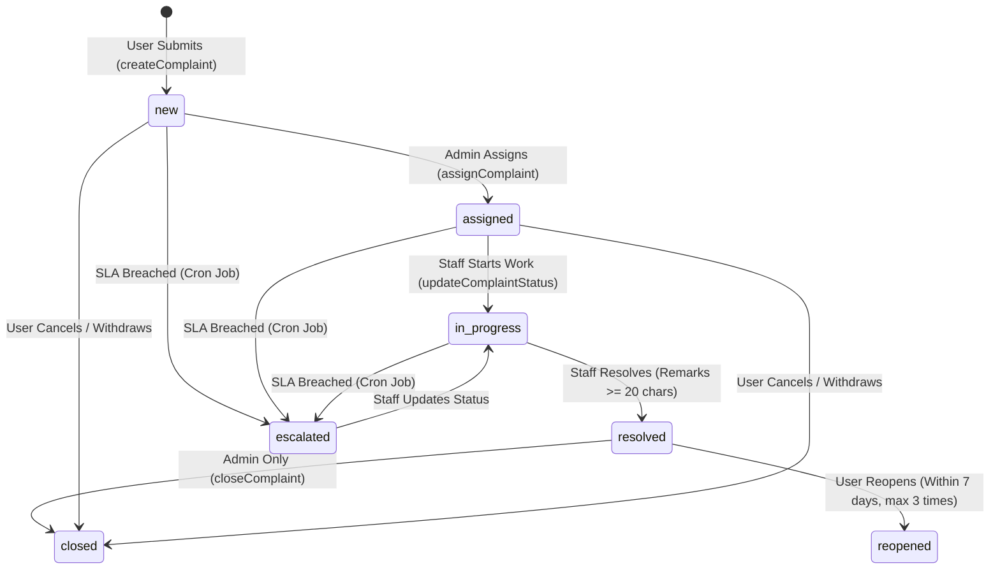

# Technical Audit: Security, Authorization & Complaint Lifecycle
## Complaint Escalation & Resolution System (CRS)

---

## 1. Executive Summary: Security & Lifecycle

Security and grievance lifecycle enforcement represent the core business integrity requirements of the CRS platform.
- **Authentication:** Dual-token JWT architecture (15-minute access token, 7-day refresh token stored in HTTP-only cookie and MongoDB user document). Supports Google OAuth with verified ID token exchange.
- **Authorization:** Granular role hierarchy (`user` < `staff` < `org_admin` < `super_admin`) enforced via server-side middleware (`protect`, `roleMiddleware`, `adminOnly`, `complaintAccess`).
- **Security Headers & Defenses:** Helmet HTTP headers, Mongo Sanitize for NoSQL injection prevention, Sanitize-HTML for rich-text XSS filtering, Express Rate Limit for brute-force throttling.

While substantial security measures are implemented, critical authorization bypasses, CSRF token handling bugs, and state machine lifecycle gaps were identified.

---

## 2. Authentication & Authorization Security Audit

### 2.1 Password Storage & Brute-Force Protection
- **Password Hashing:** Verified in [User.js:585-610](file:///d:/complaint-resolution-system/backend/models/User.js#L585-L610). Uses `bcryptjs` with salt rounds = 10 inside Mongoose `pre("save")` hook. Passwords are excluded from queries by default (`select: false`).
- **Account Lockout:** Verified in [User.js:630-660](file:///d:/complaint-resolution-system/backend/models/User.js#L630-L660) and [authController.js:478-512](file:///d:/complaint-resolution-system/backend/controllers/authController.js#L478-L512). 5 consecutive failed login attempts lock the account for 2 hours (`lockUntil = Date.now() + 2 * 60 * 60 * 1000`).

### 2.2 JWT Management & Token Rotation
- **Token Cryptography:** Access tokens and refresh tokens are signed with separate secrets (`JWT_ACCESS_SECRET`, `JWT_REFRESH_SECRET`).
- **Token Rotation & Reuse Detection:** In [authController.js:553-610](file:///d:/complaint-resolution-system/backend/controllers/authController.js#L553-L610), refresh tokens are rotated upon each `/refresh-token` invocation. If an outdated token is presented, the system detects potential token reuse theft, immediately nullifies the user's stored refresh token, and clears the cookie.
- **Recent Password Change Invalidation:** Verified in [authMiddleware.js:71-77](file:///d:/complaint-resolution-system/backend/middleware/authMiddleware.js#L71-L77). Checks `user.passwordChangedAfter(decoded.iat)` and rejects tokens issued prior to password updates.

### 2.3 Broken Access Control & Cross-Organization Leakage (Vulnerabilities)

#### Vulnerability SEC-01: Insecure Category Scoping in Public Context
- **Affected File:** [backend/controllers/categoryController.js:43-58](file:///d:/complaint-resolution-system/backend/controllers/categoryController.js#L43-L58)
- **Severity:** HIGH
- **Evidence:** When an unauthenticated client requests `/api/categories`, the controller checks for `req.query.organization`. If absent, it returns `400 "Organization context required"`. However, if any arbitrary attacker provides `organization=<victim_org_id>`, the endpoint returns the victim's internal categories, workflows, and SLA metrics without verifying whether the caller belongs to that organization.
- **Impact:** Information disclosure of internal organizational structures, department categories, and SLA metrics.
- **Remediation:** Remove public exposure of internal categories. All category listings should require authentication, scoping strictly to `req.user.organization`.

#### Vulnerability SEC-02: Direct API Authorization Bypass on Admin Endpoints
- **Affected File:** [backend/middleware/roleMiddleware.js:80-92](file:///d:/complaint-resolution-system/backend/middleware/roleMiddleware.js#L80-L92)
- **Severity:** MEDIUM
- **Evidence:** For backward compatibility, the role `"admin"` is aliased to level 3 (`org_admin`). In several controller checks, `req.user.role === "admin"` allows access without checking whether `req.user.organization` matches `complaint.organization`.
- **Impact:** An admin belonging to Organization A can invoke administrative status changes or closures against complaints belonging to Organization B by sending direct HTTP requests with the target complaint's ID.
- **Remediation:** Enforce a universal organization ownership check:
  ```javascript
  if (req.user.role !== "super_admin" && String(complaint.organization) !== String(req.user.organization)) {
    return res.status(403).json({ success: false, message: "Unauthorized cross-organization access" });
  }
  ```

#### Vulnerability SEC-03: Deprecated `csurf` and Session Desynchronization
- **Affected File:** [backend/middleware/csrf.js:1-50](file:///d:/complaint-resolution-system/backend/middleware/csrf.js#L1-L50), [backend/package.json:40](file:///d:/complaint-resolution-system/backend/package.json#L40)
- **Severity:** MEDIUM
- **Evidence:** The application includes the deprecated `csurf` library (unmaintained since 2022) with in-memory `express-session`. Because SPA clients authenticate via Authorization headers (`Bearer <token>`), CSRF attacks are fundamentally mitigated by browser CORS and SameSite cookie policies. Running `csurf` alongside stateless JWTs introduces artificial session state, memory leakage in single-instance containers, and intermittent CSRF rejections.
- **Remediation:** Remove `csurf` and `express-session`. Rely on standard Bearer authorization headers and strict CORS origin validation, which are inherently immune to CSRF.

---

## 3. Complaint Lifecycle & State Machine Audit

### 3.1 Documented Lifecycle State Machine
The documented complaint lifecycle states:
```text
Submitted (new) ──► Assigned ──► In Progress ──► Resolved ──► Closed
      │                                             ▲
      ▼                                             │
  Escalated ────────────────────────────────────────┘
```
Additional states:
- `cancelled` (Complainant withdrawal while open)
- `reopened` (Complainant reopening an unsatisfactory resolution)

### 3.2 Implementation Verification & Breakdown



### 3.3 State Machine Defects & Gaps

1. **User Closure Confirmation Missing (CRITICAL GAP):**
   - **Requirement:** After a resolver resolves a ticket, the user who submitted the grievance should verify satisfaction and close the complaint.
   - **Actual Implementation:** In [complaintRoutes.js](file:///d:/complaint-resolution-system/backend/routes/complaintRoutes.js), there is **no endpoint for a regular user to close their own complaint**.
   - In [adminController.js:1815-1865](file:///d:/complaint-resolution-system/backend/controllers/adminController.js#L1815-L1865), only an administrator can call `PUT /api/admin/complaints/:id/close`.
   - **Impact:** Tickets remain indefinitely in `resolved` status unless an administrator manually closes them.

2. **Auto-Assignment Disconnect on Submission:**
   - In [complaintController.js:153-177](file:///d:/complaint-resolution-system/backend/controllers/complaintController.js#L153-L177), new tickets are created with status `new` and `assignedTo: null`.
   - The rule-based routing engine ([assignmentController.js](file:///d:/complaint-resolution-system/backend/controllers/assignmentController.js)) is never triggered automatically upon ticket creation. As a result, tickets sit in `new` until an admin discovers them.

3. **Reopening SLA Reset Ambiguity:**
   - In [complaintController.js:1061-1150](file:///d:/complaint-resolution-system/backend/controllers/complaintController.js#L1061-L1150), when a user reopens a complaint, status is updated to `reopened` and `reopenCount` increments.
   - However, `resolutionDeadline` is not adjusted with a fresh SLA window. Because the original deadline is in the past, the very next run of `escalationScheduler` will immediately flag the reopened ticket as an SLA breach and escalate it!

---

## 4. Background SLA Scheduler Audit

In [backend/utils/escalationScheduler.js](file:///d:/complaint-resolution-system/backend/utils/escalationScheduler.js):
- **Jobs Initialized:**
  1. `checkAndEscalateComplaints` (Runs hourly `0 * * * *`): Finds active tickets where `resolutionDeadline < now` and `slaBreached != true`. Sets `slaBreached = true`, increments `escalationLevel`, transitions status to `escalated`, records history, dispatches email and in-app alerts to admins.
  2. `checkApproachingDeadlines` (Runs every 30m `*/30 * * * *`): Identifies tickets where deadline is within 4 hours. Sends warning alert to assigned staff with cooldown tracking to avoid alert fatigue.
  3. `sendDailySummary` (Runs daily at 09:00 AM `0 9 * * *`): Sends open, overdue, and escalated counts to admins.
- **Clustering / Concurrency Risk:** `node-cron` stores scheduled jobs in node process memory. Running multiple server processes (Node cluster or multi-container instances) will cause duplicate executions and duplicate alert dispatches. Requires distributed lease locks for high availability.
